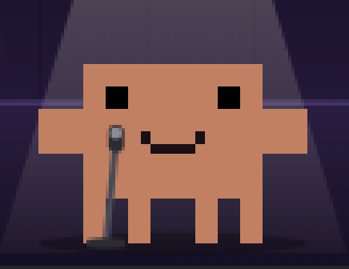

# Serenata 🌹

A mod for Claude Code: a small pixel-art stage lights up above your prompt. A
band of Claudes plays bass, drums and keys, the lead Claude sings, and every
song brings its own scenery: a rose that blooms, a monitor that turns into a
rocket, a go-live countdown, a voyage at sunset, a storm that passes.

Music, voice and artwork are all generated by the code in this repository. The
voice is built from scratch with formant synthesis: no system voices, no
third-party samples.

## Where it works

| | Claude Code desktop app | Claude Code in the terminal |
|---|---|---|
| Animated stage | ✅ | a single row with buttons |
| `/serenata` and `/canta` | ✅ | ✅ |
| Music | macOS, Windows | macOS, Windows |

On Linux everything works except the music. Serenata is a Claude Code mod, so it
does nothing in claude.ai chat or in Cowork.

## Install

From a shell (Terminal on macOS, PowerShell on Windows):

```bash
claude plugin marketplace add Marc0ne94/mdai-ff-serenata
```

```bash
claude plugin install serenata@mdai-serenata
```

In the desktop app: click **+** next to the prompt box, then **Plugins**,
**Add marketplace** with `Marc0ne94/mdai-ff-serenata`, then **Add plugin**.

Then quit and reopen Claude Code (⌘Q on macOS).

## Update

Claude Code doesn't refresh a marketplace on its own. To get the latest version:

```bash
claude plugin marketplace update mdai-serenata
```

```bash
claude plugin update serenata@mdai-serenata
```

Then quit and reopen Claude Code.

## Use

- `/serenata on` shows the band above the prompt, `/serenata off` hides it (the choice is remembered)
- `/canta` ("sing") starts the song, and turns the band on if it was off
- `/canta 2` or `/canta serenata` picks a song first, by its number or its name
- in the band: **▶ Canta**, **▶ Ancora** (again), **■ Stop**, the **Raccolta** menu
  (*La band*, *HANA*: songs of the SAP world, *Odissea*: songs of the ancient world and of its philosophers,
  or *MDO*: the Serenata's own love story, on an evening of its own)
  and the **Canzone** menu with the songs of that collection; picking one while
  the band plays starts it at once (once a song has ended, it waits for Canta)
- at the right of the band, **⚙ Impostazioni** shows the settings of the song:
  **Suono** (how it is played: the lyre of Odissea with a *Plettro* or with the
  *Dita*) and **Voce** (*Classico*, or *Avanzato*, which also sings b, g, v and z).
  Each song keeps its own, and each menu shows only when the song offers a choice.
  On the desktop each menu is labelled by a glyph (💿 🎵 🎸 🎤) so the row fits beside the stage
- songs whose words follow a text say so in their file: *Dipende da me* follows
  Epictetus, *Manual* (*Enchiridion*), chapter 1

## What it does on your computer

- **Plays the songs bundled with the mod**, in its `audio` folder, and nothing else.
  - On macOS it uses Claude Code's own audio player.
  - On Windows Claude Code has no audio player, so the mod starts one program,
    `powershell.exe`, with a short fixed script written in `hooks/register.tsx`.
    The script opens the song file with Windows' built-in media player
    (`System.Windows.Media.MediaPlayer`) and prints a dot every 200 ms while it
    plays, so the stage can start in time with the music. The only variable part
    of the script is the path of the song file inside the plugin's own folder.
    Stop, Again and quitting end that process.
- **Draws the stage** in the band above the prompt, and registers the two
  commands `/serenata` and `/canta`.
- **Remembers a few settings**, in Claude Code's plugin storage: whether the band is on, which song is picked, the song picked last in each collection, the sound and voice picked for each song, and whether the settings are shown.
- **Reads no other files, makes no network requests and sends no data anywhere.**

Its hooks: `session.start` registers the commands and resets the band,
`session.end` stops the music, `command.run` answers only its own two commands,
and `ui.render` draws the band above the prompt. It doesn't read or change your
prompts, Claude's replies, tool calls or other plugins.

## Uninstall

```bash
claude plugin uninstall serenata@mdai-serenata
```

```bash
claude plugin marketplace remove mdai-serenata
```

## How it's built

- `hooks/register.tsx`: the band, its menus, the `/serenata` and `/canta` commands, playback
- `hooks/song.ts`: the songs, their collections, sound profiles and voice styles
- `hooks/scene.ts` and `hooks/draw.ts`: the animated stage (SVG), in time with the song
- `hooks/sets/`: the scenery of each song (what stands around the band)
- `hooks/ambiences/`: the ambience of each album (the room, the lights, how the Claudes look and what they play): the club for *La band*, a data center for *HANA*, a temple for *Odissea*, a wine-red evening with rose petals for *MDO*
- `hooks/songs/`: the timing of every syllable and the audio of each song, written by `tools/render.mjs`
- `tools/songs/`: the songs themselves (tempo, chords, melody, words, and their profiles and voices)
- `tools/synth.mjs`: the engine that records a song (Node.js, no dependencies);
  `tools/profiles.mjs` defines its sound profiles and voice styles
- `tools/render.mjs`: records a song in every profile and voice it declares into
  `audio/`, skips songs that have not changed, and checks `audio/` against all songs
  (`node tools/render.mjs tools/songs/<song>.mjs [--force]`, macOS: it encodes with `afconvert`)
- `tests/`: the tests, run with `claude plugin test .`

## Italiano

Serenata è una mod per Claude Code: sopra la casella del prompt si accende un
piccolo palco in pixel art, una band di Claude suona, il Claude cantante canta
e ogni canzone porta la sua scenografia. Le canzoni sono raccolte in *La band*,
*HANA* (il mondo SAP), *Odissea* (il mondo antico e i suoi filosofi) e *MDO*
(la storia d'amore della Serenata). `/serenata on` e `/serenata off`
accendono e spengono la band, `/canta` fa partire la canzone scelta. Musica,
voce e grafica sono generate dal codice di questo repository.

---

MIT License. A personal project, unofficial and not affiliated with Anthropic.
